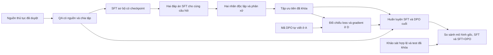

# Kế hoạch thực hiện và phối hợp nhóm — Đề tài 9

**Nhóm:** Cao Văn Hà (trưởng nhóm, tổng hợp và nộp bài), Hà Mạnh Thế, Trần Duy Hưng. Đây là tài liệu điều phối nội bộ, không thay [đề cương](../proposal/proposal.pdf) hoặc [kế hoạch dữ liệu](../proposal/data-plan.pdf) nộp tuần 1. Các nhiệm vụ chuyên môn dưới đây là **đề xuất để nhóm xác nhận**. Phạm vi Hà Nội, hộ tịch–chứng thực, phương án dùng Truyện Kiều cho phần A, khảo sát sinh viên/người thân, Thế và Hưng chấm DPO độc lập và Hà phân xử đã được thống nhất; không đồng nghĩa quyền dữ liệu, lịch hay môi trường đã được xác nhận.

**Đọc theo nhu cầu:** [giới thiệu không cần kiến thức nền](../project-overview.md) dành cho người ngoài nhóm; [lịch ngược tới buổi vấn đáp 03/12/2026](defense-plan-2026-12-03.md) dành cho nhóm. File này giữ kế hoạch và yêu cầu đầy đủ A–D.

**Căn cứ:** [PDF đề bài](../../references/DANH%20M%E1%BB%A4C%20B%C3%80I%20T%E1%BA%ACP%20L%E1%BB%9AN%20CU%E1%BB%90I%20K%C3%8C%20M%C3%94N%20H%E1%BB%8CC%20M%C3%81Y%20C%C6%A0%20B%E1%BA%A2N.pdf), bản in 12/11/2026, 46 trang: **phần I tr. 1** quy định bốn phần bắt buộc và yêu cầu đưa ít nhất một cài đặt A vào so sánh hoặc sử dụng trực tiếp ở D; **phần II tr. 2** quy định điểm, mốc, sản phẩm và tái lập; **Đề tài 9 tr. 18–19** là đặc tả A–D. Xem [ma trận yêu cầu](requirements-matrix.md) để truy vết từng mục. Mốc dưới đây theo phần II; phần I nói “2 tuần”, nên Hà cần hỏi giảng viên cách áp dụng, không tự suy ra hạn nộp.

## 1. Dự án làm gì và cần tập trung vào đâu?

**Bài toán:** người dùng hỏi bằng tiếng Việt về một thủ tục hộ tịch hoặc chứng thực tại Hà Nội. Đầu ra của trợ lý là câu trả lời nêu thông tin được hỏi, điều kiện áp dụng và trích dẫn để kiểm tra; nếu ngoài phạm vi hoặc thiếu căn cứ thì nói rõ giới hạn và hướng người dùng tới nguồn/cơ quan phù hợp. Không xử lý hồ sơ thật, không cập nhật pháp lý theo thời gian thực. Đầu ra nghiên cứu là **bằng chứng trên cùng tập test** cho thấy mô hình gốc, mô hình sau SFT và mô hình sau SFT + DPO khác nhau thế nào; không đặt trước kết luận DPO tốt hơn.

- **Nhánh nền tảng (A–C):** tự xây Transformer dự đoán **ký tự kế tiếp** trên văn bản tiếng Việt có quyền dùng; chứng minh công thức và kiểm số học. Mô hình ký tự không phải trợ lý và không dùng để tạo cặp ưu tiên.
- **Nhánh ứng dụng (D):** dùng mô hình tiền huấn luyện hỗ trợ tiếng Việt. **SFT** (tinh chỉnh có giám sát) học từ câu hỏi kèm đáp án mẫu có nguồn; **DPO** (tối ưu hóa theo ưu tiên trực tiếp) học từ hai câu trả lời của mô hình SFT cho cùng câu hỏi, sau khi con người xác định câu được ưu tiên. **LoRA** chỉ học cập nhật hạng thấp thay vì sửa toàn bộ trọng số nền; **QLoRA** kết hợp adapter LoRA với trọng số nền lượng tử hóa để tiết kiệm bộ nhớ.

| Hạng mục | Điểm | Tập trung vào bằng chứng nào? |
|---|---:|---|
| A — Tự cài đặt | 20 | Mã PyTorch chạy đúng, đối chiếu tham chiếu, có perplexity validation, kiểm LoRA và loss/gradient DPO. |
| B — Lý thuyết | 25 | Đủ sáu chứng minh, đúng giả thiết/kích thước; mỗi thành viên giải thích được, không chỉ có PDF. |
| C — Bài tập | 15 | Đủ bốn bài, phép tính lần được từng bước, dùng đúng đầu vào và nối với A/B. |
| D — Ứng dụng | 30 | Nguồn kiểm được, đủ QA và cặp ưu tiên hợp lệ, test người thật, so sánh đủ ba mô hình. Đây là nhánh phải mở sớm vì phụ thuộc người, nguồn và GPU. |
| Báo cáo, tái lập, bảo vệ | 10 | Báo cáo 25–40 trang, Git/môi trường/script, datasheet, model card và khả năng giải thích/chạy lại. Lưu bằng chứng từ đầu. |

**Thứ tự ưu tiên:** chốt hồ sơ tuần 1; tháo vướng nguồn và điều kiện khảo sát; chạy A và rà B song song; đưa SFT sơ bộ lên sớm khi có dữ liệu hợp lệ để kịp chấm DPO. Không chờ viết xong B mới làm dữ liệu, không lấy giao diện, PPO hay triển khai RAG làm ưu tiên. RAG chỉ là hướng mở rộng trong thảo luận.

## 2. Phần A — Tự cài đặt, không chỉ gọi thư viện (tr. 1, 18)

**Đầu vào:** công thức B, tensor nhỏ có kết quả tham chiếu, cấu hình mô hình và corpus tiếng Việt được phép dùng. **Đầu ra:** mã dùng lại trong `src/`, lệnh huấn luyện/đối chiếu, kết quả kiểm chứng và validation perplexity (PPL). Các tệp triển khai này là sản phẩm dự kiến, chưa có trong repo. Dùng phép toán tensor và autograd của PyTorch, nhưng không gọi mô-đun attention hoặc hàm huấn luyện dựng sẵn để làm thay phần A. Dùng thư viện chuẩn như **đường đối chiếu**, không phải đường thực thi chính.

| Mục | Đầu vào → đầu ra | Làm và nghiệm thu thế nào? |
|---|---|---|
| A.1 — Attention và decoder | Biểu diễn token, hoặc $Q,K,V$ khi kiểm riêng attention, vị trí và causal mask → trọng số chú ý và biểu diễn đầu ra. | Tính $QK^\top/\sqrt{d_k}$, che vị trí tương lai **trước** softmax, nhân trọng số với $V$. Tự chiếu Q/K/V, tách–ghép các head và chiếu đầu ra. Cộng mã vị trí sin–cos vào embedding trước khối giải mã; ghép self-attention nhân quả, residual, normalization và mạng truyền thẳng theo thiết kế đã ghi. Đối chiếu cùng tensor, trọng số và mask với tham chiếu; ở chế độ đánh giá, đổi ký tự tương lai không được đổi đầu ra của tiền tố. |
| A.2 — Mô hình ký tự | Corpus đã duyệt quyền → chuỗi ID, embedding, decoder, logits dự đoán ký tự kế tiếp, checkpoint và PPL validation. | Chuẩn hóa, chia train/validation trước khi tạo cửa sổ, xây từ vựng chỉ từ train. Dịch nhãn một vị trí và viết vòng train. Trên validation tính tổng negative log-likelihood chia số token hợp lệ, rồi lấy hàm mũ; không lấy trung bình các PPL của batch. Lưu từng seed và tổng hợp kết quả. Truyện Kiều đã audit kỹ thuật, còn chờ duyệt quyền bản số hóa. |
| A.3 — LoRA | Lớp tuyến tính đóng băng, hạng $r$, hệ số $\alpha$ và input thử → lớp LoRA và trọng số đã hợp nhất. | Tự viết nhánh $W'=W+(\alpha/r)BA$. Kiểm B khởi tạo bằng 0 cho đầu ra như base; đếm đúng $r(d+k)$ khi chỉ hai ma trận adapter được học. Sau khi adapter đã có cập nhật khác 0, đối chiếu đầu ra trước/sau merge với sai số số học đã định. |
| A.4 — DPO loss | Bốn log-xác suất chuỗi (policy/reference × chosen/rejected) và $\beta>0$ → loss, gradient của policy. | Tính chênh lệch log-prob của hai đáp án dưới policy, trừ chênh lệch tương ứng dưới reference, áp dụng $-\log\sigma$ một cách ổn định số. Reference cố định, không nhận gradient. Đối chiếu ví dụ C.4 và gradient tham chiếu; tái sử dụng hàm ở phép kiểm A–D bên dưới. |

**Bàn giao:** Thế đưa lệnh từ phiên sạch, cấu hình, kết quả tham chiếu và log; Hà cần chạy được hàm A.4 độc lập với mô hình ký tự. Hưng bàn giao bản corpus đã kiểm quyền và manifest chia tập trước huấn luyện A.2. Nếu chưa có corpus hợp lệ, vẫn làm được A.1/A.3/A.4 và kiểm tensor, nhưng chưa được báo PPL chính thức.

## 3. Phần B — Sáu chứng minh (tr. 18)

**Đầu vào:** phát biểu trong đề và tài liệu gốc, quy ước log tự nhiên, kích thước, giả thiết. **Đầu ra:** sáu chứng minh đã được nhóm rà soát, tích hợp vào báo cáo LaTeX cuối. [Bản nháp Phần B](../theory/part-b.pdf) đã biên dịch; dùng [nguồn LaTeX](../theory/part-b.tex) để sửa, không khởi viết lại từ đầu.

| Mục | Điều phải chứng minh hoặc giải thích khi bảo vệ |
|---|---|
| B.1 | Từ độc lập, kỳ vọng 0 và phương sai 1, suy ra phương sai từng tích và của tổng là $d_k$; chia $\sqrt{d_k}$ giữ thang điểm không tăng theo chiều trong giả thiết đó, giảm xu hướng bão hòa softmax. |
| B.2 | Theo dõi hoán vị qua Q/K/V, ma trận điểm và softmax theo hàng. Không PE và không mask thì đẳng biến với mọi hoán vị; causal mask cố định không bảo toàn tính này với mọi $P$. Nếu hoán vị cả mask tương ứng, nêu công thức riêng. |
| B.3 | Dùng công thức cộng sin/cos để lập một khối quay $2\times2$ cho mỗi tần số; ma trận ghép chỉ phụ thuộc độ dịch $\Delta$, không phụ thuộc vị trí $p$. |
| B.4 | Chứng minh B = 0 ban đầu, hạng tích bị chặn bởi $r$, số tham số học và chi phí suy luận sau khi merge vào lớp tuyến tính có cùng kích thước. |
| B.5 | Với $\beta>0$, hỗ trợ phân phối phù hợp và $0<Z(x)<\infty$, viết lại mục tiêu reward–KL bằng KL tới nghiệm ứng viên, chỉ rõ điều kiện duy nhất. Từ Bradley–Terry suy ra dấu margin và loss DPO khi hằng số chỉ phụ thuộc $x$ triệt tiêu. |
| B.6 | Tách cross-entropy thành entropy dữ liệu cố định + KL. Liên hệ PPL với trung bình cross-entropy theo token; không dùng nhầm trung bình token này thay tổng log-prob chuỗi của DPO. |

**Bàn giao:** đề xuất Thế rà B.1–B.3, Hưng rà B.4–B.6; hai người đổi phần để hỏi chéo, Hà kiểm nhất quán với A/C/D và tích hợp. Chỉ coi là đạt khi có thể dựng lại lập luận và nêu trường hợp giả thiết không còn đúng; PDF biên dịch được không chứng minh nội dung đúng.

## 4. Phần C — Bốn phép kiểm số học và phân tích (tr. 19)

**Đầu vào:** số liệu chính thức nếu có, cấu hình block/model thực, công thức A/B. **Đầu ra:** bốn lời giải có quy ước và bước thay số, kèm phép kiểm độc lập khi thích hợp. Thế chủ trì theo đề xuất; Hà xin đầu vào còn thiếu và bàn giao cấu hình mô hình D khi chốt.

| Mục | Cần gì? | Phải bàn giao gì? |
|---|---|---|
| C.1 — Attention ba token | Ma trận $Q,K,V$ do giảng viên cấp, $d_k=2$, causal mask. | Viết $QK^\top$, chia $\sqrt 2$, điền mask, softmax từng hàng và nhân với $V$; đối chiếu A.1. Chưa có ma trận thì chuẩn bị cách giải, không nộp ma trận tự đặt như số chính thức. |
| C.2 — Chi phí Transformer | $d_{model}$, số head, $d_{ff}$, độ dài $n$, kiểu block, có/không bias và quy ước MAC/FLOP. | Bảng tham số và phép tính cho chiếu Q/K/V/O, attention, FFN và phần phụ nếu tính. Chỉ rõ $QK^\top$ và nhân trọng số chú ý với $V$ là hai hạng bậc hai theo $n$ khi tính dense. Không gộp embedding toàn mô hình vào số tham số của một block. |
| C.3 — LoRA/QLoRA | Cấu hình mô hình nền cụ thể, kích thước Q/V từng lớp, số lớp, giả định độ dài chuỗi/batch/precision. | Lập bảng cho $r=4,8,16$: cộng $r(d_{in}+d_{out})$ cho mỗi ma trận Q/V thực sự được gắn adapter. Không giả định Q/V cùng kích thước nếu model dùng grouped-query attention. Ước lượng riêng trọng số nền 4-bit, metadata/phần không lượng tử, adapter/gradient/optimizer và activation; tách ước lượng khỏi VRAM đo trên Colab. |
| C.4 — DPO | Bốn sequence log-prob và giá trị $\beta$; đề chưa kèm bộ số, Hà xác nhận với giảng viên cách lấy số. | Viết margin trước khi nhân $\beta$, thay số vào loss và tính gradient theo log-prob policy; reference giữ cố định. Phân tích ảnh hưởng của $\beta$ ở margin dương, bằng 0 và âm, không kết luận gradient luôn tăng. Đối chiếu A.4; mọi số tự chọn phải ghi là minh họa. |

## 5. Phần D — Từ nguồn tới dữ liệu, huấn luyện và đánh giá (tr. 19)

### D.1 — Khóa nguồn trước khi tạo dữ liệu huấn luyện

**Vào:** mô tả công khai trên Cổng Dịch vụ công quốc gia và cổng địa phương, văn bản liên quan. **Ra:** sổ nguồn có mã thủ tục, địa bàn/kênh áp dụng, URL, ngày truy xuất, phiên bản hoặc hiệu lực nếu xác minh được, locator/đoạn nguồn và căn cứ quyền sử dụng. Tách quyền đọc, quyền dùng huấn luyện và quyền phân phối lại. Kiểm điều khoản, robots.txt và tần suất trước thu thập. Ghi riêng trình tự, hồ sơ, thời hạn, lệ phí và căn cứ pháp lý; trường nào thiếu thì ghi thiếu, không suy ra từ một thủ tục gần giống.

Hưng bắt đầu từ [sổ nguồn](../data/source-ledger.json) và [báo cáo đối chiếu](../data/source-audit.md). Ưu tiên xử lý chênh lệch thời hạn trích lục giữa trang quốc gia và phụ lục Hà Nội ghi **dự kiến**, cùng nguồn/biểu phí Hà Nội còn thiếu. Xác định đúng phạm vi và văn bản hiện hành; nếu chưa đủ chứng cứ, giữ `uncertain` và không biến một mốc thời hạn thành đáp án khẳng định.

### D.2 — Hai luồng dữ liệu tách biệt: QA để học, khảo sát để kiểm tra

- **SFT QA — vào:** các đoạn nguồn có căn cứ và quyền dùng. **Ra:** ở mức đề yêu cầu, tối thiểu **2.000 QA có trích dẫn** và **ít nhất 20% kiểm thủ công**. Mục tiêu nội bộ bảo thủ là đủ 2.000 cho train, có validation riêng, kiểm ít nhất 20% mỗi tập. Tạo bán tự động theo câu hỏi, điều kiện và tình huống thực sự khác nhau, không nhân số bằng diễn đạt lại. Kiểm cấu trúc/citation tự động trên toàn bộ; lấy mẫu kiểm thủ công theo thủ tục và độ rủi ro, lưu số record được người kiểm và mẫu số. Với đúng 2.000 QA, 20% tương ứng ít nhất 400 record, chưa kể phần review của validation riêng. Chia và kiểm gần trùng theo kế hoạch dữ liệu trước train; nếu phát hiện lỗi theo template/nguồn, rà lô bị ảnh hưởng, sửa rồi đóng phiên bản mới.
- **Việc đầu tiên để hiểu QA:** mở `data/review/admin-pilot-v1/review-sheet.md` của bundle nội bộ. Chọn cùng một QA để cả nhóm tập đối chiếu: đọc câu hỏi và đáp án, mở đúng URL và mục/trang, kiểm từng khẳng định, điều kiện, địa bàn, hiệu lực và citation. Ghi vào phiếu tách riêng: ID/phiên bản QA, người kiểm, thời điểm, từng tiêu chí và lý do sửa/loại. Citation tồn tại chưa bảo đảm hỗ trợ câu trả lời. Mục tiêu nội bộ là **kiểm cả 20 QA nháp**, không phải quota thay 20% của tập chính. File nháp bị Git bỏ qua; clone mới đọc [hướng dẫn nhận và review](../data/admin-pilot.md), không đẩy bundle lên Git.
- **Test người thật — vào:** câu hỏi tự người tham gia đặt sau khi đồng ý bằng văn bản; **ra:** câu hỏi đã ẩn danh, mã cụm không định danh để nhóm các câu từ cùng một người, phạm vi và căn cứ dùng để chấm. Chỉ mở khảo sát sau khi chốt kho riêng, kênh liên hệ, mốc rút và cách xin đồng ý; ẩn danh trước khi lưu dữ liệu nghiên cứu, giữ văn bản đồng ý riêng. Hưng quản lý test; không đưa câu hỏi test, bản diễn đạt lại hoặc đáp án của test vào soạn QA, SFT, DPO hay chọn cấu hình. Khóa split và kiểm trùng/gần trùng trước huấn luyện; chỉ mở test để đánh giá theo giao thức đã khóa. Không gọi QA do nhóm hoặc AI tự nghĩ là khảo sát thật. Xem [phiếu khảo sát](../data/consent-and-survey.md) và [quy trình riêng tư](../data/privacy-workflow.md).

### D.3 — SFT: mô hình học cách trả lời từ ví dụ

**Vào:** QA train/validation đã khóa, mô hình nền mã nguồn mở hỗ trợ tiếng Việt, quy mô **0,5–3 tỷ tham số**, giấy phép phù hợp nghiên cứu. **Ra:** quyết định chọn model/revision, bảng cấu hình đã thử trên validation, checkpoint/adapter SFT và log. Qwen2.5-1.5B-Instruct là **ứng viên**. Hà kiểm model card và giấy phép ở revision dự kiến, thử tiếng Việt, rồi pilot trên Colab bằng LoRA hoặc QLoRA; cấu hình cuối chọn bằng validation cho $r$, $\alpha$, learning rate và epoch. Không dùng test để chọn model/siêu tham số.

Pilot SFT có hai nhiệm vụ: kiểm nạp mô hình, huấn luyện, lưu và resume thực tế; tạo checkpoint SFT sơ bộ từ **dữ liệu đã được phép dùng** để mở dây chuyền ưu tiên. Ghi rõ version/seed/checkpoint đã sinh câu trả lời và tách pilot kỹ thuật khỏi huấn luyện cuối. T4 15.360 MiB là số người dùng báo trong phiên trước; đề khuyến nghị từ 16 GB. Chạy lại [notebook môi trường](../../notebooks/00_environment_check.ipynb) trong phiên Colab mới, không tự cài lại PyTorch và không suy ra đủ bộ nhớ DPO từ việc SFT chạy được.

### D.4 — Hai người chấm cùng từng cặp, rồi mới huấn luyện DPO

**Vào:** câu hỏi thuộc nguồn/prompt được phép, không lấy từ test, và **hai câu trả lời sinh từ checkpoint SFT cho cùng câu hỏi**. **Ra:** tối thiểu **500 cặp so sánh hợp lệ** có dấu vết hai người chấm độc lập, số đo đồng thuận trước phân xử, tập `chosen`/`rejected` để huấn luyện và checkpoint DPO. Mục tiêu nội bộ: đủ 500 cặp train có ưu tiên sử dụng được và validation riêng; sinh dư vì có cặp hòa, trùng hoặc lỗi không dùng để train.

1. Hà khóa ID cặp, checkpoint, prompt, hai câu trả lời và tạo thứ tự A/B ẩn cho người chấm; hiệu chuẩn chấm trên lô riêng trước khi chấm chính thức.
2. Thế **và** Hưng đều chấm **từng cặp**, không chia đôi 250 cặp/người. Ưu tiên đúng nội dung, đầy đủ và trích dẫn đúng; ghi lý do, hòa hoặc không hợp lệ khi cần. Không xem nhãn nhau trước khi khóa. Riêng 500 cặp đã cần ít nhất 1.000 lượt chấm, chưa kể hao hụt. Đo tốc độ trên lô thử để Hà chốt lịch theo số cặp dự kiến và thời gian mỗi người có thể dành.
3. Khóa nhãn, quy đổi A/B về cùng định danh ứng viên, báo tỷ lệ đồng thuận và Cohen's kappa nếu xác định được; **sau đó** Hà mới phân xử. Giữ nhãn gốc, lý do phân xử và số cặp bị loại. Làm theo [hướng dẫn chấm](../data/annotation-guide.md).
4. Khởi tạo policy DPO từ SFT, dùng checkpoint SFT đóng băng làm reference theo phương án đề xuất. Pilot DPO riêng để kiểm bộ nhớ và reference đúng trạng thái; chọn $\beta$ trên validation DPO. Không sửa câu trả lời bằng tay thành `chosen` và gắn nhãn là đầu ra SFT.

**Cầu nối bắt buộc A–D:** Thế và Hà dùng **một minibatch DPO thật đã kiểm định** để đối chiếu A.4 với cách tính chuẩn ở D. Dùng cùng checkpoint policy/reference, tokenizer, prompt, padding/truncation, dịch nhãn, mask phần trả lời và batch reduction. Log-prob mỗi đáp án là **tổng** trên token trả lời, không gồm token prompt/padding, không lấy trung bình theo token. Lưu ID hoặc hash cặp, sai khác log-prob, loss và gradient theo cùng logits hoặc tham số adapter, cùng cấu hình và ngưỡng sai số. Ví dụ số ở C.4 không thay cho bằng chứng này.

### D.5 — Đánh giá công bằng, không dùng test để chỉnh mô hình

**Vào:** mô hình gốc, SFT, SFT + DPO và test người thật đã khóa. **Ra:** bảng so sánh ba mô hình, chấm mù theo cặp có tỷ lệ thắng và khoảng tin cậy, phân tích lỗi và giới hạn. Cùng câu hỏi, thông tin cung cấp và giao thức giải mã đã khóa; người chấm không thấy tên mô hình, thứ tự đáp án được xáo. Ưu tiên chấm cặp SFT + DPO với SFT để đo tác động tăng thêm; lập trước danh sách đối chiếu với baseline. Không dùng nhãn chấm ưu tiên DPO làm kết quả đánh giá cuối.

- **Đúng thông tin:** số mệnh đề được nguồn xác nhận trên tổng số mệnh đề được chấm. Chấm đúng citation và đủ ý riêng; câu không có mệnh đề không tự được điểm chính xác tuyệt đối.
- **Ảo giác:** tỷ lệ câu trả lời có ít nhất một khẳng định không được nguồn hỗ trợ theo rubric. Ghi riêng lỗi kỹ thuật và trường hợp không đủ chứng cứ để kết luận đúng.
- **Từ chối:** đo đúng trên nhóm ngoài phạm vi/không đủ căn cứ; báo cả từ chối nhầm với câu trong phạm vi có thể trả lời để tránh mô hình đạt điểm chỉ nhờ né mọi câu.
- **Chấm mù:** công bố thắng/hòa/thua và mẫu số cặp hợp lệ; tỷ lệ thắng tính hòa nửa điểm. Khoảng tin cậy 95% bootstrap theo cụm người khảo sát khi một người có nhiều câu; không coi nhiều seed trả lời một câu là nhiều người độc lập. Khóa trước cách tổng hợp seed và hạn chế của người chấm nội bộ.

**Tái lập theo phần II:** chọn phương án ít nhất **5 lần huấn luyện độc lập** cho LM ký tự và 5 chuỗi `SFT_seed → DPO_seed` cho cấu hình cuối, dùng chung bản dữ liệu đã khóa; mỗi DPO có reference SFT tương ứng. Đề cho phép 5 phần gập thay cho 5 lần chạy; phương án 5 seed là thiết kế hiện tại, không phải đã chạy. Báo trung bình ± độ lệch chuẩn mẫu theo run. Baseline từ checkpoint cố định không có biến thiên huấn luyện để gán SD; 5 câu sinh từ một checkpoint không thay 5 run. Lưu seed, cấu hình, mã phiên bản code, dữ liệu/model/tokenizer, cấu hình môi trường, log, checkpoint, kết quả và dấu vết resume. Nếu ngân sách không đáp ứng, Hà báo tình trạng thực và xin giảng viên hướng dẫn, không tự hạ số run hoặc thay bằng số liệu khác.

## 6. Ai làm, ai nhận, bàn giao cái gì?

| Đầu mối | Phần chủ trì đề xuất | Bàn giao và người nhận |
|---|---|---|
| **Cao Văn Hà** | Chốt lịch với giảng viên; tích hợp hồ sơ/báo cáo; pilot Colab, chọn mô hình, SFT/DPO và tổng hợp đánh giá. | Cho Thế: cấu hình gốc để làm C.3 và minibatch hợp lệ để đối chiếu A–D. Cho Thế/Hưng: lô chấm DPO có ID và provenance. Nhận nhãn đã khóa, tính đồng thuận cùng nhóm rồi phân xử. |
| **Hà Mạnh Thế** | Cài A, đối chiếu tham chiếu; chủ trì C; rà B.1–B.3. | Cho Hà: code A.4, lệnh chạy minh chứng A–D, kết quả A/C và phần lý thuyết đã rà. Cho Hưng: định dạng corpus/manifest mà A.2 cần. Chấm mọi cặp DPO độc lập. |
| **Trần Duy Hưng** | Sổ nguồn và review QA, tổ chức khảo sát/lưu trữ riêng, chuẩn bị datasheet; rà B.4–B.6. | Cho Hà: dataset release và manifest count/rights/split, không gửi test vào luồng tuning. Cho Thế: corpus có căn cứ quyền và phiên bản. Chấm mọi cặp DPO độc lập. |

Người chủ trì chịu trách nhiệm bàn giao, không phải tự làm mọi việc. Nhóm chia tải thu nguồn/kiểm QA; **không chia tải bằng cách bỏ một trong hai nhãn độc lập của DPO**. Khi giao một việc, ghi `mục A/B/C/D → người làm → người nhận/kiểm → phiên bản hoặc đường dẫn → kết quả kiểm → việc còn chặn`. Không báo “xong” chỉ vì có file; người nhận phải biết đầu vào, cách chạy và thấy bằng chứng. Dữ liệu hạn chế, consent, checkpoint nặng và test khóa không vào Git; báo cáo tiến độ chỉ dẫn tới vị trí được phép chia sẻ.

## 7. Mốc bàn giao và việc bắt đầu ngay

| Mốc theo đề | Bắt buộc | Hành động của nhóm và dấu hiệu đạt |
|---|---|---|
| **Tuần 1** | Nộp đề cương và kế hoạch dữ liệu. | Hà cho nhóm rà hai PDF, xác nhận thông tin nộp và phạm vi. Hưng điều phối kiểm pilot/nguồn và chuẩn bị khảo sát; Thế mở A.1/A.4 và rà B. Ưu tiên nội bộ, **không phải điều kiện nộp tuần 1**: chạy pilot GPU, SFT sớm nếu có QA hợp lệ. |
| **Tuần 2** | Báo cáo tiến độ; hoàn thành A, B và bộ dữ liệu D. | Đưa SFT sơ bộ lên sớm để sinh ứng viên, đo tốc độ chấm, chia lô và duy trì hai nhãn độc lập. Duyệt B; có code và log/PPL A; chốt release QA, cặp ưu tiên và test khảo sát đã khóa, kèm count, provenance, kiểm chất lượng và số đo đồng thuận. Nếu chuỗi phụ thuộc trễ, báo rõ ngay phần không đạt và lý do. |
| **Tuần 3** | Nộp sản phẩm và bảo vệ. | Hoàn tất C và các run D; đánh giá ba mô hình, phân tích sai lệch và giới hạn tri thức thay đổi. Nộp báo cáo LaTeX **25–40 trang** có chứng minh; kho Git + mô tả môi trường + script tái lập; dữ liệu hoặc script thu thập + **datasheet**; **model card** của mô hình D. Diễn tập giải thích chéo A–D. |

**Lượt bàn giao đầu tiên:**

1. **Hà:** gửi tài liệu này cùng hai PDF tuần 1 để Thế/Hưng xác nhận phần việc; hỏi giảng viên mốc 2 tuần/tuần 3, định dạng nộp, ma trận C.1 và cách lấy số C.4. Chạy notebook Colab và chốt nơi lưu bền vững, quyền truy cập và ngân sách trước khi xếp các run.
2. **Hưng:** đọc phần D và sổ nguồn; tổ chức một lượt review mẫu chung rồi phân các QA còn lại của pilot. Trả lại danh sách lỗi nguồn/QA có ID và căn cứ, tình trạng quyền bản Truyện Kiều và checklist mở khảo sát. Chưa có quyền/consent thì không phát hành hoặc thu dữ liệu tương ứng.
3. **Thế:** đọc phần A–C, lấy B.1/B.2/B.5 để soát quy ước attention/mask/DPO. Bắt đầu A.1 và A.4 bằng các tensor đối chiếu; lập khung C.1/C.4 mà không điền số giả thành đáp án. Bàn giao một lệnh kiểm có kết quả cụ thể.
4. **Cả nhóm:** chốt người phụ trách và điểm bàn giao; ghi phạm vi hỗ trợ AI vào [nhật ký](ai-use.md) để đưa vào phụ lục, tuân thủ nguyên văn “Không dùng bản AI miễn phí”. Mỗi người lấy một mục do người khác phụ trách và giải thích lại trước buổi bảo vệ.

## 8. Điểm xuất phát và điều kiện không được bỏ qua

| Có bằng chứng trong repo | Chưa được tính là hoàn thành |
|---|---|
| Hai PDF tuần 1 và PDF sáu chứng minh B ở mức bản nháp. | Chưa có xác nhận nhóm đã duyệt/nộp; chưa có kết quả cài đặt A hoặc lời giải C trong repo. |
| [Báo cáo pilot](../data/admin-pilot-report.json): 9 nguồn, 20 QA nháp, 21 trích đoạn đã kiểm cấu trúc; ghi nhận 0 QA được người duyệt, 0 QA đủ điều kiện train. | Chưa phải release 2.000 QA; chưa có bằng chứng đã giải quyết quyền, hiệu lực hay kiểm con người. |
| [Audit Truyện Kiều](../data/char-corpus-audit-report.json) ở revision `206607`; đã kiểm chuẩn hóa và chia tập. | Chưa duyệt quyền bản số hóa, chưa huấn luyện hoặc có PPL. |
| Có biểu mẫu/rubric và notebook Colab kiểm môi trường. | Chưa có khảo sát thật/cặp DPO, pilot SFT/DPO trên Colab mới, kết quả ba mô hình hay kiểm resume thực tế. |

Nếu nguồn thiếu quyền/phiên bản, thay bằng nguồn hợp lệ trong phạm vi hoặc loại record. Nếu chưa có checkpoint SFT hợp lệ, chỉ chuẩn bị rubric và lịch; không tạo cặp ưu tiên giả để chạy cho đủ mốc. Nếu thiếu câu khảo sát thật, báo thiếu thay vì trộn QA tự sinh. Nếu GPU hết bộ nhớ, đo lại với cấu hình pilot phù hợp, ghi thay đổi và kiểm lại riêng SFT/DPO; thiếu nguồn lực ảnh hưởng yêu cầu nào thì Hà báo đúng yêu cầu đó với giảng viên. Các quyết định/bằng chứng mới cập nhật tại [bối cảnh và tiến độ](project-context.md).
