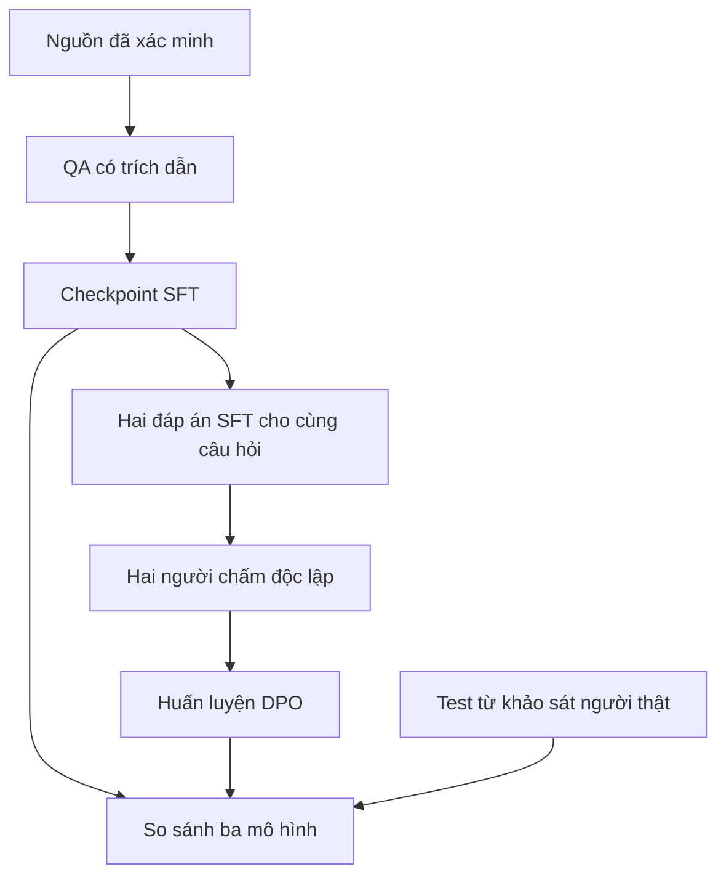

# Kế hoạch thực hiện và phối hợp nhóm — Đề tài 9

**Nhóm:** Cao Văn Hà (trưởng nhóm, tổng hợp và nộp bài), Hà Mạnh Thế và Trần Duy Hưng. Đây là kế hoạch làm việc nội bộ, không thay hai tài liệu nộp tuần 1: [đề cương](../proposal/proposal.pdf) và [kế hoạch dữ liệu](../proposal/data-plan.pdf).

**Đọc nhanh:** mục 1 giới thiệu bài toán, mục 2 nêu cách cả nhóm làm việc và mục 4 giải thích cách làm từng phần A–D. [Bản giới thiệu cho người mới](../project-overview.md) giải thích bài toán qua ví dụ. [Lịch bàn giao](defense-plan-2026-12-03.md) đi ngược từ hạn hoàn thành **23h59 ngày 01/12/2026**; vấn đáp **03/12/2026**.

## 1. Nhóm đang làm gì?

Người dùng hỏi, ví dụ: **“Tôi muốn chứng thực bản sao ở Hà Nội. Cần chuẩn bị gì?”** Nhóm muốn xây một trợ lý thử nghiệm có thể trả lời bằng tiếng Việt, nêu đúng điều kiện và chỉ ra nguồn chính thức để người dùng kiểm tra. Nếu thiếu căn cứ hoặc ngoài phạm vi, trợ lý phải nói rõ thay vì đoán. Đây không phải dịch vụ nộp hồ sơ hay nguồn tư vấn pháp lý.

Đề có **hai nhánh, không phải hai phiên bản của cùng một mô hình**:

- **A–C: Tự xây để hiểu.** Nhóm tự viết Transformer nhỏ học đoán ký tự kế tiếp trên văn bản tiếng Việt. Nhóm chứng minh các công thức và làm bài tính tay để hiểu và kiểm tra mã. Mô hình ký tự **không** dùng để trả lời thủ tục.
- **D: Tinh chỉnh để thử ứng dụng.** Nhóm dùng một mô hình tiếng Việt có sẵn. Trước hết, mô hình học từ câu hỏi và đáp án mẫu có nguồn: đó là **SFT** (tinh chỉnh có giám sát). Sau đó, mô hình học từ những cặp đáp án đã được người chấm so sánh: đó là **DPO** (tối ưu hóa theo ưu tiên trực tiếp). Cuối cùng, nhóm đo xem mô hình gốc, SFT và SFT + DPO khác nhau thế nào. DPO không mặc định tốt hơn.

## 2. Nhóm phối hợp thế nào?

**Hà là người thực hiện chính xuyên suốt A–D.** Không có phần nào giao riêng cố định cho một thành viên. Thế và Hưng luân phiên rà soát các đầu việc nhỏ để cả hai đều tham gia vào mã, chứng minh, bài tập và dữ liệu/thí nghiệm.

1. **Hà làm và gửi bản đầu.** Với mỗi đầu việc, gửi đường dẫn và phiên bản, cách kiểm, kết quả đã có và chỗ cần xem. Không chờ xong cả phần mới gửi.
2. **Thế và Hưng thay phiên rà trước.** Ở mỗi đầu việc, một bạn rà chi tiết, bạn kia đối chiếu kết quả chính hoặc chạy lại phép kiểm quan trọng. Đổi lượt ở đầu việc tiếp theo; không chia theo chữ A, B, C hay D. Ví dụ: chạy lại một phép kiểm mã, tự giải lại một bước chứng minh/tính toán, hoặc đối chiếu một QA với URL và đúng mục nguồn.
3. **Hà sửa và tổng hợp.** Ghi lại góp ý, kết quả sau sửa và phần còn vướng. Cả ba có thể giải thích cách làm trước khi chốt; trao đổi hiện vật theo quyền truy cập, không chia sẻ tập test để chọn cấu hình.

**Bắt đầu:** Hà chuẩn bị bản chạy A.1/A.4, kiểm Colab và xác nhận cách nộp/đầu vào C với giảng viên. Cả nhóm chọn một chứng minh và một QA mẫu để thử cách rà soát ngay, song song với kiểm nguồn và điều kiện khảo sát.

**Riêng chấm cặp DPO:** Thế và Hưng vẫn **đều chấm từng cặp độc lập**, không chia lượt; Hà phân xử sau khi khóa nhãn và đo đồng thuận. Đó là quy trình tạo nhãn, khác với việc luân phiên rà soát.

## 3. Đề bắt buộc gì, nhóm tự chọn gì?

**Nguồn chính:** [PDF đề bài](../../references/DANH%20M%E1%BB%A4C%20B%C3%80I%20T%E1%BA%ACP%20L%E1%BB%9AN%20CU%E1%BB%90I%20K%C3%8C%20M%C3%94N%20H%E1%BB%8CC%20M%C3%81Y%20C%C6%A0%20B%E1%BA%A2N.pdf), bản 12/11/2026. Phần I–II ở tr. 1–2 nêu quy định chung; Đề tài 9 ở tr. 18–19 nêu việc cụ thể. Dùng [ma trận yêu cầu](requirements-matrix.md) để kiểm từng mục trước khi đánh dấu hoàn thành.

| Điều bắt buộc theo đề | Cách nhóm chọn để thực hiện |
|---|---|
| Phần A huấn luyện mô hình ký tự trên văn bản tiếng Việt thuộc phạm vi công cộng hoặc có giấy phép mở. | Chọn *Truyện Kiều* nếu xác minh được quyền của bản số hóa đang dùng. |
| Phần D lấy thủ tục từ cổng quốc gia **và** cổng địa phương. Test là câu hỏi từ khảo sát người thật, tách khỏi huấn luyện. | Làm hộ tịch–chứng thực tại Hà Nội; dự kiến mời sinh viên và người thân tự nguyện tham gia. |
| Ít nhất 2.000 cặp hỏi–đáp có nguồn, kiểm thủ công ít nhất 20%; ít nhất 500 cặp so sánh do hai người chấm độc lập. | Đặt mục tiêu đủ 2.000 QA và 500 cặp ưu tiên **cho tập train**, có tập kiểm định riêng. Đây là mục tiêu nội bộ, không phải đề quy định số lượng riêng cho từng tập. |
| Ít nhất một cài đặt A phải được dùng hoặc đối chiếu trong D. | Dùng hàm mất mát DPO tự viết ở A để so sánh với cách tính chuẩn trên một lô dữ liệu thật ở D. |
| Báo cáo kết quả trên ít nhất 5 lần chạy hoặc 5 phần gập. | Dự kiến 5 lần huấn luyện độc lập theo seed cho mô hình ký tự và 5 chuỗi SFT → DPO cho phần D. Sinh 5 câu từ cùng một bản lưu mô hình (checkpoint) không phải 5 lần huấn luyện. |

**Không cần làm web, PPO hay triển khai RAG.** Đề yêu cầu thảo luận vì sao kiến thức thủ tục có thể lỗi thời và RAG (tra cứu tài liệu khi trả lời) có thể giúp gì trong tương lai.

## 4. Làm từng phần như thế nào?

### A — Tự cài đặt và kiểm chứng (20 điểm, tr. 1 và 18)

**Đầu vào:** công thức, ví dụ nhỏ để đối chiếu và văn bản tiếng Việt có quyền dùng. **Bàn giao:** mã PyTorch, ghi chú dẫn xuất, lệnh chạy, kết quả đối chiếu và PPL trên tập kiểm định.

| Mục | Làm gì và kiểm thế nào? |
|---|---|
| **A.1 — Transformer** | Tự viết chú ý tích vô hướng có chia tỷ lệ, chú ý đa đầu, mặt nạ nhân quả, mã vị trí sin–cos và một khối decoder. Mặt nạ không cho một vị trí nhìn các token phía sau: đổi phần tương lai thì đầu ra phần trước không được đổi. So với cách tính/thư viện chuẩn trên cùng đầu vào; không dùng mô-đun attention hoặc vòng huấn luyện dựng sẵn để làm thay. |
| **A.2 — Mô hình ký tự** | Tách train và validation (tập kiểm định) trước khi tạo các đoạn huấn luyện; lập từ vựng từ train. Huấn luyện mô hình đoán ký tự tiếp theo. Báo **perplexity (PPL)**, thước đo mô hình khó đoán đến mức nào: lấy hàm mũ của mất mát trung bình theo token trên validation. Chưa duyệt quyền bản văn thì chưa huấn luyện hoặc báo PPL từ bản đó. |
| **A.3 — LoRA** | Bọc một lớp tuyến tính bằng hai ma trận nhỏ thay vì huấn luyện lại toàn bộ trọng số. Kiểm số tham số học đúng $r(d+k)$. Sau khi LoRA có cập nhật khác 0, gộp cập nhật vào trọng số gốc và kiểm đầu ra trước/sau gần bằng nhau trong sai số số học. |
| **A.4 — Hàm mất mát DPO** | Nhận log-xác suất của hai đáp án dưới mô hình đang học và mô hình tham chiếu cố định. Tính loss (mất mát) và kiểm gradient (đạo hàm dùng để cập nhật mô hình) so với cách tính chuẩn. Giữ hàm này dùng được độc lập để đưa vào D. |

**Dẫn xuất là phần bắt buộc, không phải việc thêm.** Bàn giao ghi chú giải thích cách đi **từ mô hình xác suất hoặc bài toán tối ưu tới công thức được cài**. Ví dụ: xác suất dự đoán ký tự kế tiếp dẫn tới mất mát huấn luyện thế nào; mô hình ưu tiên và kết quả B.5 dẫn tới hàm mất mát DPO ra sao. Có thể dẫn lại chứng minh ở B, nhưng phải chỉ rõ công thức tương ứng nằm ở đoạn mã nào. Chỉ có mã chạy và kiểm thử đạt chưa đủ cho A.

### B — Rà và hiểu sáu chứng minh (25 điểm, tr. 18)

**Đầu vào:** phát biểu của đề và bản nháp ([PDF](../theory/part-b.pdf), [nguồn LaTeX](../theory/part-b.tex)). **Bàn giao:** sáu chứng minh được nhóm rà soát, có giả thiết, bước suy luận và kết luận, để đưa vào báo cáo. Không xem việc PDF biên dịch thành công là chứng minh đúng.

1. **B.1:** Vì sao phương sai của $q^\top k$ bằng $d_k$ dưới giả thiết đề cho, và vì sao chia $\sqrt{d_k}$?
2. **B.2:** Nếu đổi thứ tự đầu vào thì đầu ra của self-attention đổi theo thế nào? Nêu điều kiện không có mã vị trí và lưu ý mặt nạ nhân quả cố định không giữ tính này với mọi hoán vị.
3. **B.3:** Vì sao dịch vị trí một lượng cố định tương đương áp dụng các khối quay sin–cos?
4. **B.4:** Vì sao khởi tạo LoRA không đổi trọng số gốc, cập nhật có hạng tối đa $r$, ít tham số học và có thể gộp khi suy luận?
5. **B.5:** Vì sao bài toán thưởng có phạt KL có nghiệm duy nhất, và mô hình Bradley–Terry dẫn tới DPO thế nào? Nêu $\beta>0$, miền hỗ trợ của phân phối và điều kiện chuẩn hóa hữu hạn.
6. **B.6:** Vì sao tối thiểu hóa cross-entropy cũng tối thiểu hóa KL, và PPL liên quan thế nào đến trung bình theo token?

Rà theo từng chứng minh và đổi người rà trước giữa các lượt. Cả nhóm hỏi chéo và kiểm ký hiệu có khớp mã, bài tập và thí nghiệm không. Mỗi người có thể bị hỏi về **bất kỳ** chứng minh hoặc đoạn mã nào.

### C — Bốn bài tính và phân tích (15 điểm, tr. 19)

**Đầu vào:** số liệu chính thức nếu có, cấu hình block/mô hình và công thức. **Bàn giao:** lời giải đủ bước, ghi rõ đầu vào và đối chiếu bằng mã khi phù hợp.

| Bài | Kết quả cần giao |
|---|---|
| **C.1** | Tính tay attention cho 3 token, $d_k=2$, có mặt nạ nhân quả. **Dùng Q/K/V do giảng viên cung cấp.** Nếu chưa có, viết cách giải; ví dụ tự đặt chỉ là minh họa. |
| **C.2** | Đếm tham số và phép tính của một khối Transformer theo chiều mô hình, số đầu, chiều lớp truyền thẳng và độ dài chuỗi. Chỉ phần nào tăng theo bình phương độ dài chuỗi; ghi quy ước đếm. |
| **C.3** | Lấy kích thước thực của hai phép chiếu Q/V của một mô hình nền cụ thể. Tính tham số LoRA với $r=4,8,16$ và ước lượng bộ nhớ QLoRA 4 bit. Ghi giả định, tách số ước lượng khỏi số VRAM đo. |
| **C.4** | Tính loss và gradient DPO từ bốn log-xác suất; giải thích ảnh hưởng của $\beta$. PDF chưa kèm bộ số. Hà hỏi cách lấy số; trước đó có thể làm công thức và ví dụ ghi rõ là minh họa. |

### D — Dữ liệu, tinh chỉnh và đánh giá trợ lý (30 điểm, tr. 19)

**Đầu vào:** nguồn thủ tục công khai, mô hình nền và câu hỏi khảo sát tách riêng. **Bàn giao:** bộ dữ liệu có nguồn và kết quả kiểm, checkpoint SFT/DPO, bảng so sánh ba mô hình và giới hạn của trợ lý.

1. **D.1 — Kiểm nguồn trước.** Với mỗi thủ tục, lưu trình tự, hồ sơ, thời hạn, lệ phí, căn cứ pháp lý, URL, thời điểm truy xuất và phiên bản/hiệu lực khi xác minh được. Kiểm điều khoản, `robots.txt`, giới hạn truy cập và quyền sử dụng nội dung. Nguồn quốc gia và tài liệu Hà Nội đang có điểm khác nhau về thời hạn trích lục; chưa rõ văn bản nào áp dụng thì ghi **chưa xác minh**, không tự chọn đáp án. Bàn giao [sổ nguồn](../data/source-ledger.json) có căn cứ kiểm lại được.
2. **D.2 — Tạo QA để học và giữ test riêng.** Soạn bán tự động từ nguồn hợp lệ, loại câu trùng/gần trùng và chia tập trước huấn luyện. Với đúng 2.000 QA, ít nhất **400 câu** phải được người kiểm thật; kiểm tự động không tính vào tỷ lệ này. Test dùng câu hỏi do người thật tự đặt. Chỉ thu sau khi có đồng ý bằng văn bản; ẩn danh trước khi lưu vào kho nghiên cứu. Giữ test và các câu diễn đạt lại ngoài SFT, DPO và quá trình chọn cấu hình. Xem [phiếu khảo sát](../data/consent-and-survey.md) và [quy trình riêng tư](../data/privacy-workflow.md).
3. **D.3 — Chạy SFT.** Đã [chuẩn bị pilot QLoRA trên Kaggle](../../README.md#d3--chuẩn-bị-sft-trên-kaggle) với revision cố định của Qwen2.5-1.5B-Instruct (1,54B, hỗ trợ tiếng Việt theo model card, Apache-2.0); chưa chọn cấu hình cuối. Chỉ chạy khi đúng release D.2 và quyền dùng nền tảng. Dùng validation để chọn $r$, $\alpha$, tốc độ học và epoch, giữ test độc lập. Lưu checkpoint và kiểm nối lại ở phiên mới. Phiên T4 của A.2 không chứng minh SFT/DPO vừa bộ nhớ; đo riêng hai bước.
4. **D.4 — Chấm cặp rồi chạy DPO.** Với mỗi câu hỏi ngoài test, sinh **hai đáp án từ checkpoint SFT thật**. Thế và Hưng chấm độc lập theo đúng nội dung, đủ ý và trích dẫn đúng. Khóa nhãn, báo mức đồng thuận rồi Hà mới phân xử; giữ nhãn gốc và lý do loại cặp. Không chia đôi 500 cặp cho hai người. Dùng các cặp ưu tiên để tập DPO, giữ mô hình SFT tham chiếu cố định và chọn $\beta$ trên validation DPO. Chi tiết ở [hướng dẫn chấm](../data/annotation-guide.md).
5. **D.5 — So sánh trên cùng test đã khóa.** Chạy mô hình gốc, SFT và SFT + DPO trên cùng bộ câu hỏi, theo giao thức đã định trước. Đo đúng thông tin đối chiếu nguồn, tỷ lệ bịa/khẳng định không có căn cứ và từ chối đúng ngoài phạm vi. Khi chấm mù, người chấm không biết câu trả lời do mô hình nào tạo. Báo tỷ lệ thắng cùng khoảng tin cậy, không dùng nhãn DPO làm kết quả đánh giá cuối. Nêu giới hạn do thủ tục thay đổi và hướng RAG; không đoán trước kết quả.

**Hồ sơ kiểm 20 QA nháp:** Xem kết quả vòng đầu ở `data/review/admin-pilot-v1/manual-review-20-qa-v1.md`. Kết quả người kiểm xác nhận cho hai câu sửa được lưu riêng trong phiếu v2: 001 và 004 đều chấp nhận nội dung, không cần sửa thêm. Kết luận nội dung không cấp quyền train; pilot không thay tập chính hay khảo sát thật. Xem [hướng dẫn và điều kiện phát hành](../data/admin-pilot.md).

**Cầu nối A–D sẽ bàn giao gì?** Lấy một lô nhỏ gồm các cặp thật đã kiểm định ở D. Giữ cùng mô hình, câu hỏi, cách tách token và phần đáp án được tính điểm. So hàm DPO tự viết với cách tính chuẩn, ghi sai khác **loss và gradient**. Với DPO, cộng log-xác suất các token **trong đáp án**, bỏ prompt và phần đệm; PPL thì dùng trung bình theo token. Một ví dụ tự đặt của C.4 không thay được phép kiểm này.

## 5. Khi nào bàn giao và nộp gì?

| Mốc trong phần II (tr. 2) | Nhóm cần có gì? |
|---|---|
| **Tuần 1** | Nộp đề cương và kế hoạch dữ liệu. Kiểm QA mẫu, chạy Colab và khởi động SFT sớm là việc nội bộ để giảm rủi ro, **không phải điều kiện nộp tuần 1**. |
| **Tuần 2** | Báo cáo tiến độ và hoàn thành **A, B và bộ dữ liệu D**. Vì cặp DPO cần đầu ra từ SFT, phải mở luồng dữ liệu và GPU song song với A–C; không đợi xong lý thuyết. |
| **Tuần 3** | Nộp và bảo vệ. Phần báo cáo, tái lập và bảo vệ là **10 điểm**. Kiểm đủ bốn nhóm sản phẩm nêu dưới đây. |

**Bốn nhóm sản phẩm cuối:**

- **Báo cáo LaTeX 25–40 trang**, có đủ chứng minh và kết quả thực tế. Khai báo phạm vi hỗ trợ AI trong phụ lục theo [nhật ký AI](ai-use.md); đề ghi “Không dùng bản AI miễn phí”.
- **Kho Git, tệp môi trường và lệnh tái lập.** Lưu seed hay hạt giống ngẫu nhiên, cấu hình, phiên bản mã/dữ liệu/mô hình, môi trường, kết quả và checkpoint đủ để tiếp tục chạy. Chọn siêu tham số trên validation. Báo **trung bình ± độ lệch chuẩn** trên số lần chạy/phần gập theo đề.
- **Dữ liệu hoặc script thu thập kèm datasheet**, tức thẻ mô tả nguồn, quyền dùng, việc lọc/chấm và cách chia tập. Không đưa dữ liệu cá nhân, phiếu đồng ý, test khóa, nguồn hạn chế hay trọng số nặng lên Git.
- **Model card** cho mô hình D, mô tả mô hình, dữ liệu, đánh giá, giới hạn và cách dùng phù hợp.

**Hạn hoàn thành toàn dự án: 23h59 ngày 01/12/2026.** Theo [lịch bàn giao](defense-plan-2026-12-03.md), nhóm kiểm lại khả năng hoàn tất D tối **26/11**, bàn giao minh chứng tối **30/11** và dự kiến khóa gói nội bộ lúc **20h00 ngày 01/12** để còn thời gian kiểm trước hạn. **02/12** chỉ diễn tập trên bản đã khóa; **03/12** vấn đáp. Hà xác nhận cách nộp và hiện vật cần mang. Phần I ghi “2 tuần”, phần II mô tả mốc đến tuần 3; giữ nguyên yêu cầu của đề, không tự suy ra được giảm phạm vi khi nguồn, giờ chấm hoặc GPU không đủ.

## 6. Hiện có gì, còn thiếu gì?

| Đã có bằng chứng | Chưa được coi là xong |
|---|---|
| Hai PDF tuần 1; sáu chứng minh B bản nháp; A.1–A.4 có mã và kiểm số học; [C.1](../../notebooks/08_causal_attention_example.ipynb), [C.2](../../notebooks/05_transformer_block_cost.ipynb), [C.3](../../notebooks/06_lora_qlora_cost.ipynb) và [C.4](../../notebooks/07_dpo_loss_gradient.ipynb) có lời giải đã kiểm trên CPU. | Chưa có xác nhận đã duyệt/nộp hồ sơ hoặc phản biện phần B. C.1 và C.4 dùng số minh họa, không phải đầu vào do giảng viên cấp. |
| [Pilot](../data/admin-pilot.md): 20/20 có kết luận nội dung vòng đầu; 001/004 v2 đều được Hà chấp nhận; 21 đoạn dẫn đã qua kiểm cấu trúc. | 0 bản ghi `approved`, 0 QA sẵn sàng train; còn vướng nguồn/quyền và chưa có tập SFT chính. |
| [A.2 trên Kaggle](../data/char-corpus.md): Truyện Kiều 1911, 5 seed, PPL validation 10,1948 ± 0,0628 (SD mẫu); có protocol khảo sát/chấm. | Chưa đối chiếu log/checkpoint Kaggle. Chưa có khảo sát thật, cặp DPO, kết quả SFT/DPO hay đánh giá ba mô hình. |

**Điểm lệch cần xử lý:** SFT pilot dự kiến cuối tuần 1/đầu tuần 2 chưa có dữ liệu được phép dùng. Ưu tiên D.1–D.2 và chuẩn bị khảo sát song song A–C; không chờ đủ 2.000 QA mới thử SFT nếu đã có pilot hợp lệ. Tập chính vẫn theo kế hoạch: ≥2.000 QA train, validation riêng và kiểm ≥20% ở mỗi split dùng; ≥500 cặp DPO train đạt sau lọc, validation riêng. Các yêu cầu theo đề và ngưỡng nội bộ được phân biệt trong [kế hoạch dữ liệu](../proposal/data-plan.md). Dùng [cổng rà tiến độ D](defense-plan-2026-12-03.md) để báo nếu chưa thể kịp, không đổi ngưỡng hoặc hạn.

Chỉ cập nhật [tiến độ](project-context.md) khi có hiện vật hoặc log kiểm chứng. Việc đã ghi trong kế hoạch **không phải** việc đã hoàn thành.
